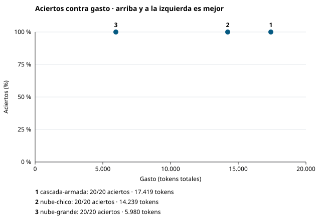

# Lab 1 · Decisión

## 1. Tabla de resultados

| Configuración  | Aciertos | Inválidas | Tokens | Segundos | Costo estimado (USD) |
| -------------- | -------- | --------- | ------ | -------- | -------------------- |
| cascada-armada | 20/20    | 0         | 17419  | 164.5    | 0.0                  |
| nube-chico     | 20/20    | 0         | 14239  | 79.7     | 0.0                  |
| nube-grande    | 20/20    | 0         | 5980   | 136.2    | 0.0                  |

## 2. Gráfico

Las tres configuraciones terminaron acertando el 100% de los reclamos, asi que quedan a la misma altura en ese eje y se puede tomar una decisión analizando el costo, que al usar modelos free se analiza en tokens. `nube-grande` gasta 5980 tokens, `nube-chico` 14239 y `cascada` 17419. Claro ganador `nube-grande` mismo aciertos que las otras configuraciones e incluso superando a `cascada` en tiempo con 136.2s

## 3. Casos importantes

Todos los casos resultaron en su valor esperado. La diferencia que encuentro es en la confianza:

- Reclamo R18: `nube-chico` respondió con confianza baja 1251 tokens-5.77s mientras que el `nube-grande` con confianza alta y 481 tokens-29.43s. Como ambos acertaron cascada sobreescaló y sumó costo inncesario.
- Reclamo R19: mismo caso que R18, `nube-chico` dudó de una respuesta correcta y escaló a `cascada` produciendo el costo más alto 1732 tokens
- Reclamo R17: el único caso donde ambas configuraciones duraron resultando en confianza baja

## 4. Regla de ruteo de modelos

| Tarea                           | Modelo o configuración                     | Por qué se elige                                                                             | Riesgo y privacidad                                                                                          | Cuándo escalar                                  |
| ------------------------------- | ------------------------------------------ | -------------------------------------------------------------------------------------------- | ------------------------------------------------------------------------------------------------------------ | ----------------------------------------------- |
| Clasificar reclamos             | nube-grande                                | 20/20 en ambos pero el grande usa menos tokens                                               | Los reclamos podrian tener información personal como emails, número de cuentas etc                           | si la respuesta es inválida o la confianza baja |
| Análisis de sospecha de fraudes | nube-grande y supervisión o chequeo humano | Acertó todas pero produjo una con confianza baja, el control humano aqui me parece necesario | Representa un alto impacto al cliente, definir bien si un reclamo cae en la categoria es de suma importancia | Siempre que se tenga una confianza baja         |
| Reclamos ambiguos               | nube-grande                                | Acertó todas(una con confianza baja R17) mientras que nube-chico todas con confianza baja    | Si se clasifica un reclamo erroneamente podria tardar más en resolverse                                      | Siempre que se tenga una confianza baja         |

## 5. Lo que el chequeo no verifica

No se obtuvieron casos con confianza alta y resultado equivocado. Así que el chequeo no dejó pasar ningún error. Como es una muestra pequeña no significa que no puedo ocurrir.

Un mejor chequeo justamente sería testearlo versus una muestra mucho más grande.
